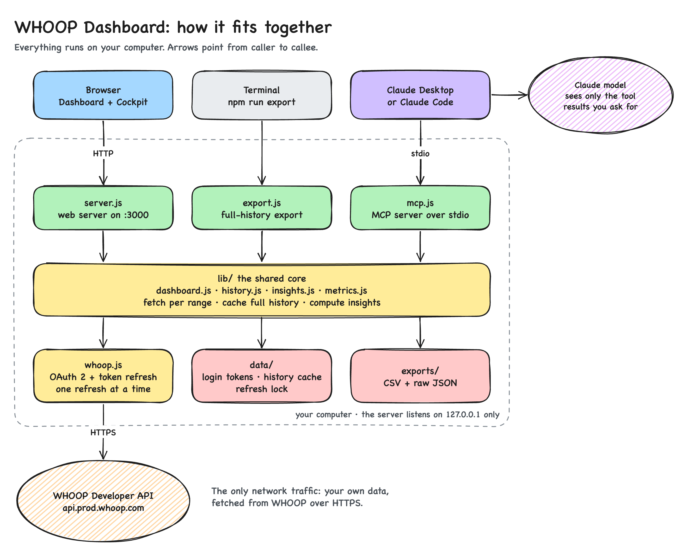

# Contributing

Thanks for helping out. Bug reports, ideas for new metrics, design feedback and pull
requests are all welcome.

## Protect your health data

Your WHOOP data is personal. When you open an issue or a pull request:

- **Use sample data for screenshots.** Click **Preview with sample data**, or open
  http://localhost:3000/?demo, and reproduce the problem there.
- **Don't attach** files from `data/` or `exports/`, and never paste your `.env`,
  client secret or tokens.
- If a bug only shows up with your own data, describe its shape instead: "a workout
  with no score", "a night with no recovery", "a range with no steps".

## Running it locally

You need Node.js 20.12 or newer.

```bash
npm run dev
```

This restarts the server whenever a file changes. Open http://localhost:3000/?demo
to work on sample data without a WHOOP login. To work against the real API, follow
the [setup guide](docs/setup.md).

For the MCP server, run `npm install` once, then see the [MCP guide](docs/mcp.md).

## How the code is organized



| Path | What it does |
|---|---|
| `server.js` | Serves the page and handles login, logout and the data API. Listens on 127.0.0.1 only. |
| `lib/whoop.js` | OAuth and API calls. Refreshes the token automatically, one refresh at a time, with a lock file shared with the MCP server. |
| `lib/dashboard.js` | Fetches cycles, recovery, sleep and workouts for a range and joins them per day. |
| `lib/history.js` | Caches the full history in `data/history.json` and re-fetches only the last week. |
| `lib/insights.js` | Every computed insight: HRV baseline, illness signals, training load, sleep regularity, chronotype and more. |
| `lib/demo.js` | Generates the sample data. |
| `lib/export.js`, `export.js` | The full-history export. |
| `lib/metrics.js` | The metric registry, period parsing and trend math used by the MCP server. |
| `mcp.js` | The MCP server. |
| `public/` | The page, styles, dashboard logic (`app.js`) and the hand-written SVG charts (`charts.js`). |
| `scripts/screenshots.mjs` | Regenerates the documentation screenshots. |

## Principles

- **No build step, no dashboard dependencies.** The dashboard runs on plain Node.js,
  and the page is plain HTML, CSS and JavaScript. Only the MCP server has
  dependencies. Please keep it that way.
- **Local only.** The page loads nothing from other sites, and the server talks only
  to WHOOP's API. A strict Content Security Policy enforces this. Set styles from
  JavaScript through `element.style`, because inline `style` attributes are blocked.
- **Explain every number.** A new metric needs a short explanation in
  [docs/metrics.md](docs/metrics.md), including how it's calculated and, for health
  claims, a source.
- **Honest charts.** Every chart has a trendline, a table view and readable labels in
  both themes. Trend colors only appear when a metric has a clear healthy direction.

## Before you open a pull request

- Check your change in light and dark mode, and at phone width.
- Check the browser console for errors.
- Check it with sample data, and with an empty range if your change touches charts.
- If the change is visible, regenerate the screenshots as described below.

## The live demo

The [live demo](https://toniilein.github.io/whoop-dashboard/) is the same dashboard in a
static mode: `lib/demo.js` generates the sample data in the browser, so it needs no server
and never touches real data. GitHub Actions rebuilds it on every push to `main`
(`.github/workflows/pages.yml`).

To build it, or to build and preview it at the same path GitHub Pages uses:

```bash
node scripts/build-site.mjs
```

```bash
node scripts/preview-site.mjs
```

The preview runs at http://localhost:8765/whoop-dashboard/. Keep the dashboard's
sample-data code free of Node-only APIs, because the demo runs it in the browser.

## Updating the screenshots

The screenshots in `docs/screenshots/` are made from sample data only. The script
refuses to capture anything else. Start the dashboard, then run:

```bash
node scripts/screenshots.mjs
```

It needs Google Chrome. Set `CHROME_PATH` to use another Chromium-based browser, or
`DASHBOARD_URL` if the dashboard runs on another port.

## Updating the diagrams

There are two diagrams, both drawn in [Excalidraw](https://excalidraw.com):

| Diagram | Source | Shown in |
|---|---|---|
| How it works, for users | [docs/how-it-works.excalidraw](docs/how-it-works.excalidraw) | README |
| Technical architecture | [docs/architecture.excalidraw](docs/architecture.excalidraw) | This guide |

1. Open [excalidraw.com](https://excalidraw.com), choose **Open** from the menu and
   pick the source file.
2. Make your changes, then save the scene back to the same file.
3. Export it as PNG at 2× scale to `docs/<name>-light.png`. Export it again with
   **Dark mode** switched on to `docs/<name>-dark.png`.
