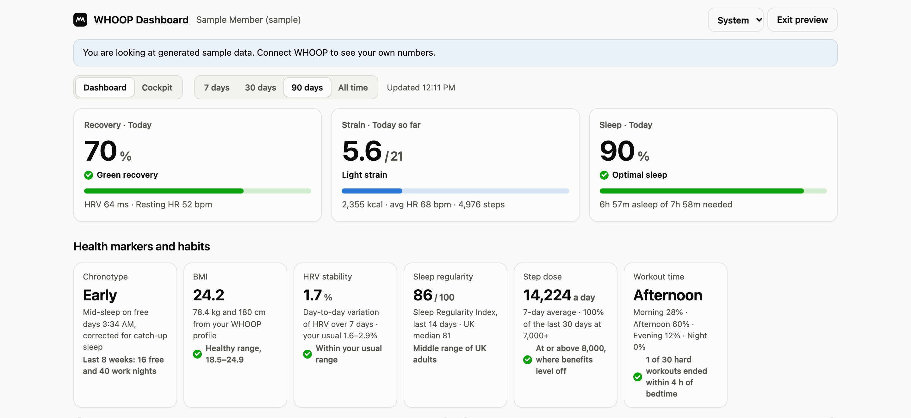
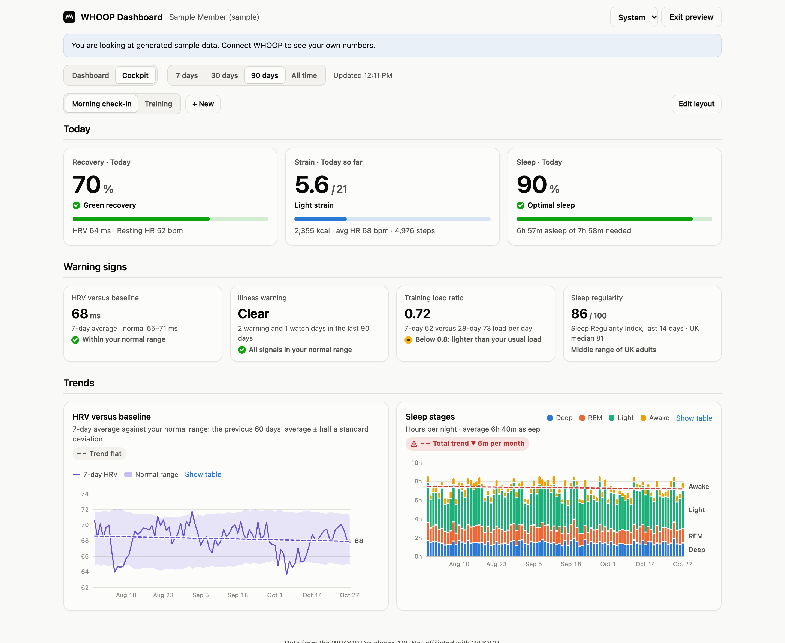
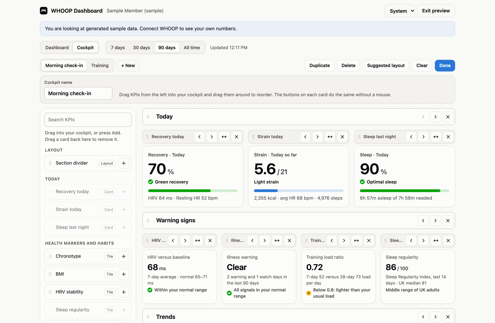
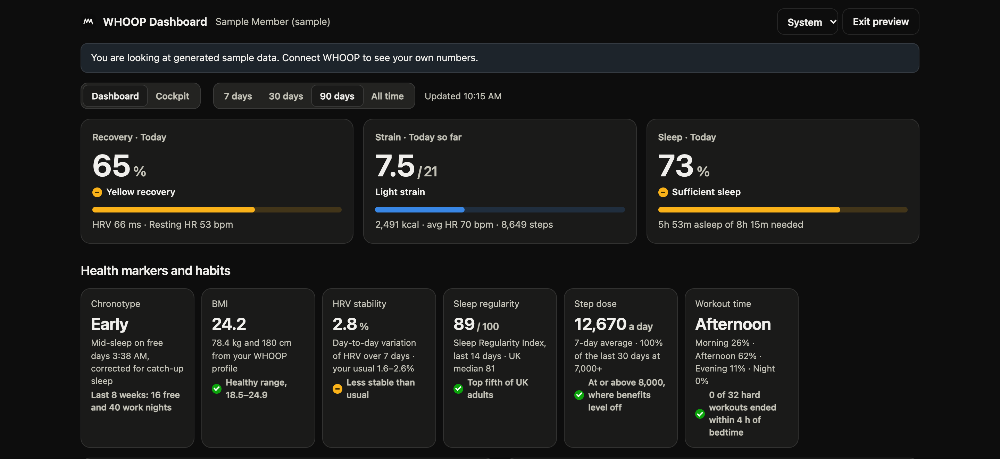
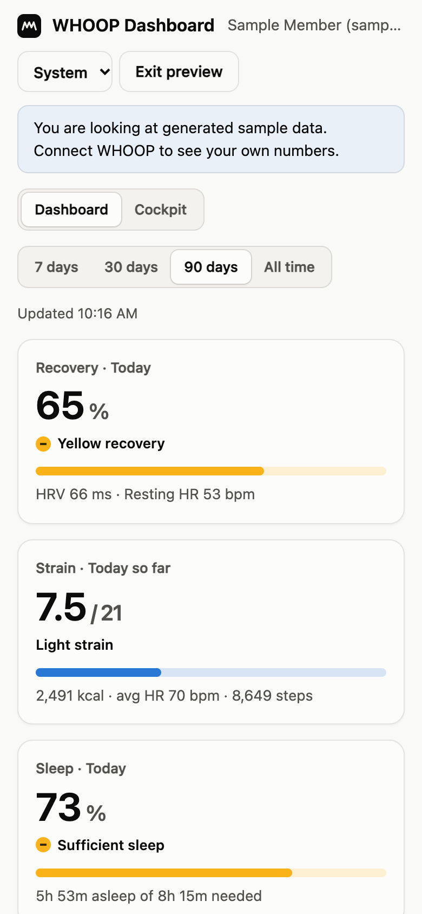
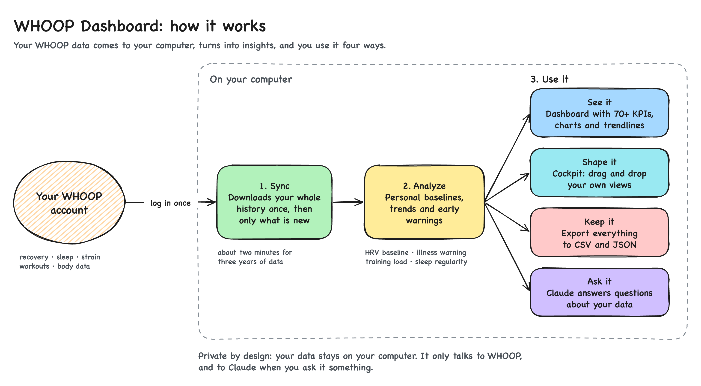

# WHOOP Dashboard

**Your WHOOP data, on your own computer.** A local dashboard with 70+ KPIs and
research-backed health markers, a drag-and-drop cockpit, a full-history export,
and an MCP server so Claude can answer questions about your data.

**[Try the live demo](https://toniilein.github.io/whoop-dashboard/)** in your browser. It runs
on sample data, so you don't need a WHOOP or any setup.



> Uses the official [WHOOP Developer API](https://developer.whoop.com). Not
> affiliated with or endorsed by WHOOP. Your data and login stay on your machine.

## Features

- **Everything the API offers, in one place.** Recovery, HRV, resting heart rate,
  blood oxygen, skin temperature, respiratory rate, strain, steps, calories, sleep
  stages, sleep need and debt, workouts and heart-rate zones, from 7 days to your
  whole history.
- **Insights the WHOOP app doesn't show.** HRV against your personal baseline, an
  illness warning from four overnight signals, training load ratio, Sleep
  Regularity Index, HRV stability, chronotype, step dose and a VO2 max estimate,
  each with the research behind it. See [how the metrics work](docs/metrics.md).
- **Trends that tell you if they're good news.** Every chart has a trendline. Healthy
  trends turn green, unhealthy ones turn red with a warning.
- **A year at a glance.** Calendar heatmaps show every day of the last 12 months for
  recovery, sleep, strain and the illness warning, one square per day.
- **Your own cockpit.** Drag any of 70+ KPIs into a grid, add section dividers and save
  several layouts, for example a morning check-in and a training view.
  [Read more](docs/cockpit.md).
- **Ask Claude about your data.** A built-in [MCP server](docs/mcp.md) lets Claude
  Desktop, Claude Code or any MCP client query your history: "how has my HRV changed
  since the summer?" or "what happens to my recovery after hard days?".
- **Export everything.** One command saves your full history as CSV and raw JSON.
  [Read more](docs/export.md).
- **Private by design.** Runs on `localhost`, stores your login with owner-only
  permissions, and talks to nothing but WHOOP's own API. No accounts, no cloud, no
  tracking.
- **No build step.** Plain Node.js and hand-written SVG charts. The dashboard has no
  dependencies; only the optional MCP server needs `npm install`.
- **Light and dark, desktop and phone.** Follows your system theme and works at
  phone width.

## Screenshots

All screenshots use the built-in sample data.

| Insights | Health monitor |
|---|---|
|  |  |
| **Cockpit** | **Building a cockpit** |
|  |  |
| **Dark theme** | **Sleep** |
|  |  |

<p align="center"></p>

## Quick start

You need [Node.js](https://nodejs.org) 20.12 or newer and a WHOOP membership.

1. **Create a free WHOOP developer app** at the
   [WHOOP Developer Dashboard](https://developer-dashboard.whoop.com). Add
   `http://localhost:3000/` as its redirect URL and enable all six `read:` scopes.
   The [setup guide](docs/setup.md) walks through every field.
2. **Get the code and add your app's credentials:**

   ```bash
   git clone https://github.com/toniilein/whoop-dashboard.git
   cd whoop-dashboard
   cp .env.example .env
   ```

   Then put your client ID and client secret into `.env`.
3. **Start the dashboard.** There's nothing to install for it:

   ```bash
   npm start
   ```

4. **Open http://localhost:3000** and click **Connect WHOOP**. Or click
   **Preview with sample data** to look around first.

Everyone uses their own developer app, so no one else's credentials or data are
involved. New WHOOP apps start on the "Sandbox" tier, which allows up to 10 members:
plenty for you and a few friends.

## Documentation

| Guide | What's in it |
|---|---|
| [Setup](docs/setup.md) | Creating the WHOOP app, configuration, troubleshooting |
| [Metrics](docs/metrics.md) | Every KPI and insight, how it's calculated, and the research behind it |
| [Cockpit](docs/cockpit.md) | Building your own dashboards with drag and drop |
| [MCP server](docs/mcp.md) | Connecting Claude Desktop, Claude Code or other MCP clients |
| [Export](docs/export.md) | Saving your full history as CSV and JSON |
| [Contributing](CONTRIBUTING.md) | Project structure, development, screenshots |

## How it works

1. **Sync.** You log in to WHOOP once. The dashboard downloads your whole history to
   your computer, then only fetches what's new.
2. **Analyze.** It works out your personal baselines, trends and early warnings.
3. **Use it.** See it on the dashboard, shape your own cockpit, export everything, or
   ask Claude about it.

<picture>
  <source media="(prefers-color-scheme: dark)" srcset="docs/how-it-works-dark.png">
  
</picture>

Your data stays on your computer. The dashboard only talks to WHOOP, and to Claude
when you ask it something through the MCP server. Developers can find the technical
architecture in the [contributing guide](CONTRIBUTING.md#how-the-code-is-organized).

## Privacy and security

- The server listens on `127.0.0.1` only and rejects requests addressed to any other
  host name.
- Your WHOOP login is stored in `data/tokens.json` with owner-only file permissions.
  Your client secret stays in `.env` and is never sent to the browser.
- `.env`, `data/` and `exports/` are gitignored, so personal data can't be committed by
  accident.
- **Log out** deletes the stored login and cached history. To revoke access entirely,
  remove the app in the WHOOP app's settings.
- Anyone using your computer can open the dashboard while you're logged in.

## Not medical advice

This is a personal data tool, not a medical device. Insights such as the illness
warning are heads-ups based on your own trends, not diagnoses. Talk to a doctor about
anything health-related.

## License

[MIT](LICENSE). WHOOP is a trademark of WHOOP, Inc. This project is independent and
not affiliated with WHOOP.
