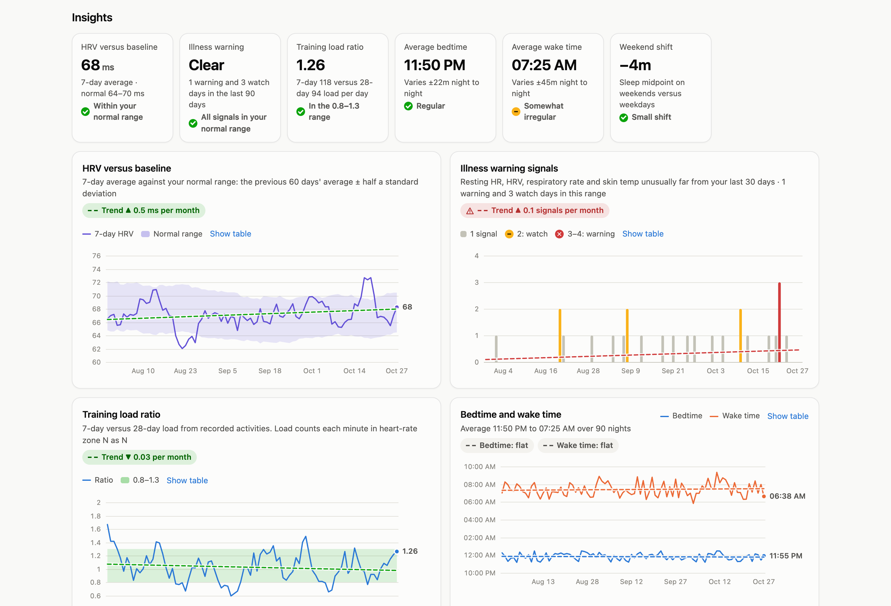
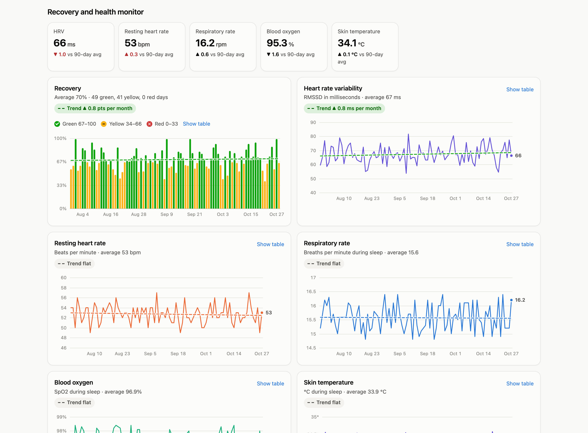
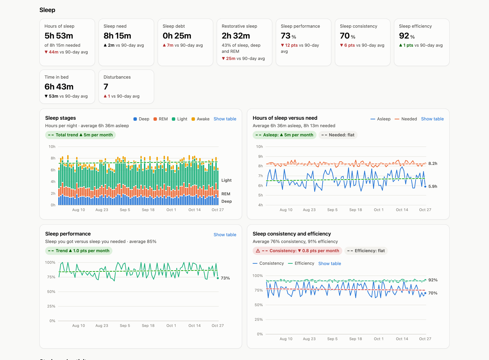

# Metrics and insights

This page lists what the dashboard shows and how every number is calculated, with
the research behind the insights. The calculations live in `lib/insights.js` and
`public/app.js`.

## What the dashboard shows

Like the WHOOP app, the page opens with today's **Recovery**, **Strain** and
**Sleep**. Seven sections follow.

| Section | Tiles | Charts |
|---|---|---|
| Health markers and habits | Chronotype, BMI, HRV stability, sleep regularity, step dose, workout time | HRV stability, sleep regularity, step dose, workout time of day |
| Insights | HRV versus baseline, illness warning, training load ratio, average bedtime, average wake time, weekend shift | HRV versus baseline, illness warning signals, training load ratio, bedtime and wake time |
| Recovery and health monitor | HRV, resting heart rate, respiratory rate, blood oxygen, skin temperature | Recovery, HRV, resting heart rate, respiratory rate, blood oxygen, skin temperature |
| Sleep | Hours of sleep, sleep need, sleep debt, restorative sleep, performance, consistency, efficiency, time in bed, disturbances | Sleep stages, hours versus need, performance, consistency and efficiency |
| Strain and activity | Day strain, steps, average heart rate, and for the last 7 days: workouts, heart-rate zones 1–3, zones 4–5, strength activity | Day strain, steps, heart-rate zone time, strength activity time |
| Energy and distance | Calories today, and for the last 7 days: total burn, workout calories, workout share, distance, elevation gain | Calories burned (workouts versus rest of day), calories by sport, distance |
| Fitness and Healthspan | VO2 max estimate, max heart rate, resting heart rate | VO2 max estimate, Healthspan inputs table |

## Reading the numbers

- **Comparisons:** each tile compares the latest value with the average for the
  selected range. Tiles marked "last 7 days" compare with the weekly average.
- **Trendlines:** every chart has a dashed least-squares trendline. The rate next to
  the chart title is per week for ranges up to a month, per month up to a year, and
  per year beyond that. Today's unfinished strain and steps are left out of the trend.
- **Trend colors:** a trend in the healthy direction is green. An unhealthy one is
  red with a warning icon, and the dashed line takes the same color. Metrics without
  a clear healthy direction stay grey: strain, skin temperature, respiratory rate and
  sleep timing. A change smaller than 2% of the metric's level over the shown period
  counts as flat. The training load trend is green while the ratio stays inside
  0.8–1.3.

## Insights

The insights always use your full history, whatever range you pick, so the
baselines stay right even on the 7-day view.

### HRV versus baseline

Your 7-day average HRV against a normal range. The range is the average of the 60
days before that week, plus or minus half a standard deviation. Below the range for
a while usually means accumulated stress, too little sleep or illness. Above it is
normally good news.

### Illness warning

Each night, four signals are compared with your previous 30 days: resting heart
rate, HRV, respiratory rate and skin temperature. A signal counts as out of range
when it is 1.5 standard deviations or more in the unhealthy direction. Two signals
mean "watch" and three or four mean "warning". This is a heads-up to take it easy,
not a diagnosis.

### Training load ratio

The 7-day average training load divided by the 28-day average, often called the
acute:chronic workload ratio. Load is zone-weighted minutes from recorded
activities (Edwards TRIMP): a minute in heart-rate zone 3 counts as 3. WHOOP strain
isn't used, because its logarithmic scale squeezes the ratio towards 1. The common
guideline is 0.8 to 1.3, and above 1.5 means a sharp jump in load.

### Bedtime, wake time and weekend shift

These use the main sleep of each night in the selected range. Regularity is the
night-to-night standard deviation. The weekend shift compares the sleep midpoint of
nights before Saturday and Sunday with the other nights.

## Health markers

### Chronotype

Mid-sleep on free days (nights before Saturday and Sunday) over the last 8 weeks,
corrected for catch-up sleep. This is the MSFsc measure from the Munich ChronoType
Questionnaire. Rough groups: early before 4:00, intermediate 4:00–4:59, late from
5:00. It isn't valid if you use an alarm on weekends.

### BMI

Weight divided by height squared, from your WHOOP profile, with the WHO categories.
It doesn't account for muscle mass.

### HRV stability

The 7-day coefficient of variation of ln(HRV), compared with your previous 60 days
(average ± 1 standard deviation). Higher means less stable, which studies link
with fatigue and overreaching (Flatt 2017).

### Sleep Regularity Index

How often you are in the same state, asleep or awake, 24 hours apart, over the
previous 14 days. It runs from -100 to 100 (Phillips 2017). UK Biobank reference:
median 81, bottom fifth below 71.6, top fifth above 87.3 (Windred 2024). It uses
each night's main sleep and only compares days the strap was worn. WHOOP doesn't
share wake bouts, so it reads a little high.

### Step dose

The 7-day average steps, and the share of the last 30 days at 7,000 or more. The
benefits level off around 8,000–10,000 steps a day under age 60 (Paluch 2022).

### Workout time

Workouts by local start hour: morning 5 AM–12 PM, afternoon 12–5 PM, evening
5–9 PM, night 9 PM–5 AM. It also counts hard workouts (strain 10 or more) that ended
within 4 hours of your next sleep. A study of WHOOP members linked those to later,
shorter sleep and lower HRV (Leota 2025).

## Activity, energy and fitness

- **VO2 max** is an estimate: 15.3 × max heart rate ÷ resting heart rate (Uth 2004).
  WHOOP's own value uses a different method and isn't in the API.
- **Calories** are WHOOP's daily energy expenditure, converted from kilojoules
  (÷ 4.184). "Workouts" is the sum of recorded workouts that day. "Rest of day" is
  the remainder, which includes your resting metabolism.
- **Distance and elevation** come only from workouts that record them, so they're
  hidden when a range has none.
- **Heart-rate zone time** only covers recorded activities, because the API has no
  all-day heart rate.
- **Strength activity** counts weightlifting, powerlifting, functional fitness and
  similar sports.
- **Healthspan inputs** are the nine metrics WHOOP uses for WHOOP Age. Eight can be
  derived from the API. Lean body mass and WHOOP Age itself can't.

## Not available through the API

These aren't shared by the WHOOP Developer API, so the dashboard can't show them:
WHOOP Age and Pace of Aging, WHOOP's own VO2 max, Stress Monitor, strain target,
Strength Trainer muscular load, journal and behaviors, lean body mass, blood
pressure, ECG and continuous all-day heart rate.

## Sources

- Edwards S. *The Heart Rate Monitor Book.* Fleet Feet Press, 1993. (TRIMP)
- Flatt AA, Esco MR, Nakamura FY. Individual heart rate variability responses to
  preseason training in high level female soccer players. *J Strength Cond Res*, 2017.
- Leota J et al. Dose-response relationship between evening exercise and sleep.
  *Nature Communications*, 2025.
- Paluch AE et al. Daily steps and all-cause mortality: a meta-analysis of 15
  international cohorts. *Lancet Public Health*, 2022.
- Phillips AJK et al. Irregular sleep/wake patterns are associated with poorer
  academic performance and delayed circadian and sleep/wake timing.
  *Scientific Reports*, 2017.
- Roenneberg T, Wirz-Justice A, Merrow M. Life between clocks: daily temporal
  patterns of human chronotypes. *J Biol Rhythms*, 2003. (Munich ChronoType
  Questionnaire, MSFsc)
- Uth N et al. Estimation of VO2max from the ratio between HRmax and HRrest: the
  heart rate ratio method. *Eur J Appl Physiol*, 2004.
- Windred DP et al. Sleep regularity is a stronger predictor of mortality risk than
  sleep duration. *Sleep*, 2024.
